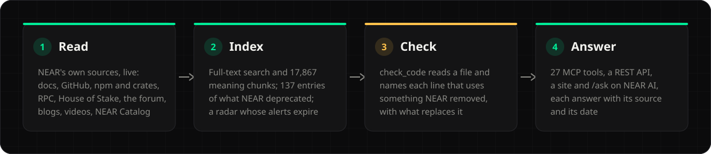
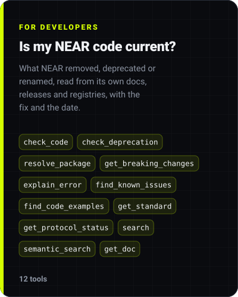
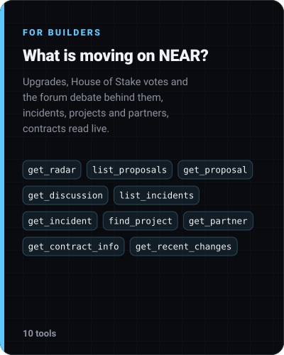
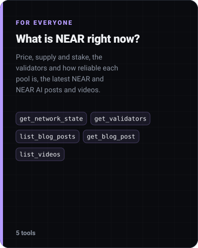

<p align="center">
  
</p>

<p align="center">
  <a href="#connect-an-agent"></a>
  <a href="https://near-pedia.xyz"></a>
  <a href="https://near-pedia.xyz/ask"></a>
  <a href="https://near-pedia.xyz/for-ai"></a>
</p>

<p align="center">
  <a href="https://github.com/UnityNodes/near-pedia/actions/workflows/ci.yml"></a>
  <a href="LICENSE"></a>
  
  
  
</p>

Live NEAR knowledge for AI agents. NEARpedia is an MCP server and REST API that tells a coding agent when the NEAR code it is about to write is already stale, and gives the replacement, with a source and a date on every answer. The same index serves people researching NEAR: a site and an `/ask` chat about protocol upgrades, House of Stake votes, validators, projects and incidents.

Built for the NEAR Hackathon (1–14 November 2026, tracks `open` and `agents`). Live at [near-pedia.xyz](https://near-pedia.xyz) since 2 November 2026; the MCP endpoint `https://near-pedia.xyz/mcp` needs no key.

Demo video, 81 seconds: [youtu.be/L1mbTEWWraE](https://youtu.be/L1mbTEWWraE). Submission post on X, with a 45-second promo: [x.com/UnityNodes/status/2118447685397291123](https://x.com/UnityNodes/status/2118447685397291123).

> [!TIP]
> Agents write NEAR code from what they remember, and NEAR keeps moving. A few changes from the last year, the first two in the weeks before this hackathon, that a model trained earlier cannot know about:
>
> - [`near-sdk-js`](https://github.com/near/near-sdk-js) is archived and its README says "DO NOT USE".
> - [nearcore 2.14.0](https://github.com/near/nearcore/releases/tag/2.14.0) removes `DelegateV2`.
> - NEAR Lake is shut down and its tutorials are gone from docs.near.org.
> - `@near-js/*` packages stopped at 2.5.1; the maintained package is `near-api-js` 7.x, which ships no `keyStores`.
>
> Package registries rarely flag any of this, so the agent finds out when the build or the transaction fails. The official [`near/agent-skills`](https://github.com/near/agent-skills) are static instructions, and [`nearai/near-mcp`](https://github.com/nearai/near-mcp) performs chain actions rather than answering what is current.

## How it works

<p align="center">
  
</p>

The deprecation engine is fed by six signals: archived repositories, "deprecated / do not use" in a README, npm and crates.io deprecation or yank flags, removals in release notes, the docs' own deprecation markers and deleted pages, and long-dormant packages with a live successor. Weak signals are reported as "possibly deprecated". The radar keeps only what is true now: every alert ends when its subject resolves.

### NEAR's role

NEAR is the data and part of the runtime, not a logo:

- The content is NEAR's own: docs.near.org, the GitHub orgs of NEAR, npm and crates.io packages of NEAR, gov.near.org and NEAR Catalog. Without it there is nothing to check code against.
- NEAR RPC (FastNEAR, then NEAR's own endpoint) gives the protocol version, the validator vote, contract methods and the House of Stake proposals (view calls on `vote.dao` and `venear.dao`). Without it `get_protocol_status`, `get_validators`, `get_contract_info` and the proposal readers serve their last snapshot, marked stale, and `check_code` cannot say whether `DelegateV2`'s removal is live on a network.
- NEAR AI Cloud runs `/ask` (a model in a TEE whose attestation is verified before an answer is shown) and the embeddings and reranker behind `semantic_search`. Without it `/ask` answers 503 and `semantic_search` matches words only.
- NEAR mainnet holds one hash of the database a day in `contracts/db-anchor`, an account with no keys. Without it nobody outside this server can check that a copy of the index is the one recorded on a given date.
- NEAR Agent Market sells the migrator agent (`scripts/agent-market-worker.ts`); without it that agent has no buyers' channel.

## Three ways in

<p align="center">
  
  
  
</p>

| You want to | Go to |
| --- | --- |
| Give your coding agent the tools | [Connect an agent](#connect-an-agent), or [/for-ai](https://near-pedia.xyz/for-ai) for Claude.ai and ChatGPT (a custom connector, no install), Claude Desktop, Cursor, VS Code, Windsurf, Cline, Continue, Zed and JetBrains |
| Check a file in the browser | [/check](https://near-pedia.xyz/check): a near-sdk-js contract is prefilled, press Check and each stale line comes back with its severity, the replacement and the sources |
| See what NEAR deprecated, with the evidence | [/deprecations](https://near-pedia.xyz/deprecations) |
| Follow the protocol upgrade and the validator vote | [/protocol](https://near-pedia.xyz/protocol), [/radar](https://near-pedia.xyz/radar) |
| Read House of Stake proposals and how the vote stands | [/governance](https://near-pedia.xyz/governance) |
| Ask in plain words | [/ask](https://near-pedia.xyz/ask), answered by a model in a TEE on NEAR AI Cloud |

## Connect an agent

```bash
claude mcp add --transport http nearpedia https://near-pedia.xyz/mcp
```

Or, in Claude Code, the plugin: the same server plus a skill that checks NEAR code before and after writing it. From a shell:

```bash
claude plugin install nearpedia --marketplace UnityNodes/near-pedia
```

Or inside a Claude Code session:

```
/plugin marketplace add UnityNodes/near-pedia
/plugin install nearpedia@nearpedia
```

Then ask Claude Code to write a NEAR contract in JavaScript with meta-transactions and to check it with the nearpedia tools: `check_code` names near-sdk-js and `DelegateV2` with their replacements.

<details>
<summary><strong>Codex, Cursor and other clients</strong></summary>

Codex, in `~/.codex/config.toml`:

```toml
[mcp_servers.nearpedia]
url = "https://near-pedia.xyz/mcp"
```

Cursor, in `~/.cursor/mcp.json` or `.cursor/mcp.json`:

```json
{
  "mcpServers": {
    "nearpedia": { "url": "https://near-pedia.xyz/mcp" }
  }
}
```

Claude.ai and ChatGPT take the URL as a custom connector, with no install. Claude Desktop, Cursor, VS Code, Windsurf, Cline, Continue, Zed and JetBrains each name the fields differently; [near-pedia.xyz/for-ai](https://near-pedia.xyz/for-ai) has the exact block for each.

</details>

Rate limits, per address, from `mcp-server.ts`: `/mcp` allows 300 tool calls per 15 minutes (`initialize`, `tools/list` and notifications do not count). Every `/api/v1/*` route shares 120 requests per 15 minutes; on top of that `/api/v1/search` allows 20 a minute and `/api/v1/ask` 30 an hour and 40 a day. The `RateLimit-*` headers on a route report its own tightest limit (on `/ask`, whichever of the hour and the day has fewer requests left). A refusal is a 429 with a `Retry-After` header. `https://near-pedia.xyz/api/v1/health` answers whether the server is up.

## Check every pull request

A GitHub Action runs `check_code` on the files a pull request changes and leaves one comment: each line that uses something NEAR deprecated, removed or changed, what replaces it, and the source. Add `.github/workflows/nearpedia.yml`:

```yaml
name: NEARpedia
on: pull_request
permissions:
  contents: read
  pull-requests: write
jobs:
  check:
    runs-on: ubuntu-latest
    steps:
      - uses: UnityNodes/near-pedia/github-action@main
```

No key is needed. Checked on 3 November 2026, [near-examples/coin-flip-examples#37](https://github.com/near-examples/coin-flip-examples/pull/37) adds 7 such lines: the `@near-js/*` packages that near-api-js 7 replaced, and dependencies a major version or more behind. To see the comment the action writes, open [UnityNodes/near-pedia#4](https://github.com/UnityNodes/near-pedia/pull/4), a demo pull request that adds stale NEAR code to this repository: 12 findings in one comment and annotations on the changed lines. Inputs, outputs and a way to run it against any public pull request without installing anything are in [`github-action/README.md`](github-action/README.md).

How common this is: on 8 November 2026, 48 of the 162 NEAR Hackathon projects with a public repository used something NEAR deprecated, removed or changed, most often the `@near-js/*` packages, `actionCreators` and `keyStores`. The method, and a script that runs the same check on any set of clones without naming anyone, are in [`docs/demo/hackathon-stale-count.md`](docs/demo/hackathon-stale-count.md). The 162 repositories are not listed, so as not to single out other teams; the figure can be rerun on any set, not rechecked on the same one.

## Try it against the live API

No install, no key:

```bash
# a file written from memory: three findings, each with its replacement and sources
curl -s -X POST https://near-pedia.xyz/api/v1/check-code -H 'Content-Type: application/json' \
  -d '{"filename":"contract.ts","code":"import { NearBindgen } from \"near-sdk-js\";\nconst d = { DelegateV2: signed };\nconst ks = new keyStores.InMemoryKeyStore();"}'

# the mainnet protocol version, the upgrade vote by stake and the voting schedule
curl -s 'https://near-pedia.xyz/api/v1/protocol?network=mainnet' | head -c 600

# what is changing now, each alert with what ends it
curl -s https://near-pedia.xyz/api/v1/radar | head -c 600
```

`check_code` answers: line 1 imports near-sdk-js, archived, use near-sdk in Rust; line 2 builds a `DelegateV2` action, removed in nearcore 2.14.0, use `Delegate` signed with a regular access key; line 3 uses `keyStores`, which near-api-js 7 does not ship, use a `KeyPairSigner`.

## Run it yourself

The judge path, from a clean clone. It needs no key and, after `npm ci`, no network:

```bash
git clone https://github.com/UnityNodes/near-pedia
cd near-pedia
npm ci
npm run db:seed            # a local database from scripts/fixtures/near-seed.json, under a second
npx tsx mcp-server.ts      # MCP and REST on :3131, leave it running
```

In another terminal:

```bash
curl -s -X POST http://127.0.0.1:3131/api/v1/check-code -H 'Content-Type: application/json' \
  -d '{"filename":"contract.ts","code":"import { near } from \"near-sdk-js\";\nconst a = { DelegateV2: signed };"}'
curl -s 'http://127.0.0.1:3131/api/v1/protocol?network=mainnet' | head -c 600
curl -s http://127.0.0.1:3131/api/v1/deprecations/delegate-v2 | head -c 600
curl -s http://127.0.0.1:3131/api/v1/health
claude mcp add --transport http nearpedia http://127.0.0.1:3131/mcp
```

You see two `check_code` findings (near-sdk-js on line 1, `DelegateV2` on line 2, each with its replacement and sources), the mainnet protocol version with the validator vote and the voting schedule from the nearcore 2.14.0 release notes, and the `DelegateV2` entry with the docs sentence it is built from. `npm run build && npm run start` serves the site on :3130 from the same database, `/protocol` and `/deprecations` included.

The seed is a copy of real rows, not invented ones: the docs pages and release notes the curated deprecations quote, the NEAR packages and repositories they name, and the latest protocol snapshot per network with the one from the epoch before it, taken from the live syncs by `scripts/build-seed-fixture.ts` on the date in the fixture's `recorded_at`. The deprecation index is built from them by the same engine the server runs, so 26 entries come out instead of about 154, and the protocol snapshot is reported as stale: it is the network as it was on that date. Two steps refresh parts of it from live sources with no key: `npx tsx scripts/sync-protocol.ts` (RPC, about 10 seconds) and `npx tsx scripts/sync-docs.ts` (docs.near.org, a few seconds). `explain-error` and `contracts/:account` answer from curated data and live RPC either way:

```bash
curl -s -X POST http://127.0.0.1:3131/api/v1/explain-error -H 'Content-Type: application/json' \
  -d '{"error_text":"wasm execution failed with error: MethodResolveError(MethodNotFound)"}'
curl -s http://127.0.0.1:3131/api/v1/contracts/intents.near | head -c 600
```

The full index reads every source live instead. It needs `GITHUB_TOKEN` (a token with no scopes is enough; without one GitHub allows 60 calls an hour, and the run stops before its first step and says so) and takes 45 to 60 minutes, most of it the YouTube step, plus about 50 minutes more with `NEARAI_API_KEY` for the embeddings:

```bash
rm -f data/nearpedia.db    # the seed only fills a new database
GITHUB_TOKEN=<token> npm run sync:near
```

The same curls against `https://near-pedia.xyz` instead of `http://127.0.0.1:3131` answer from the live index. `npm test` runs 1027 tests without network or keys; [`docs/TESTING.md`](docs/TESTING.md) says what each part checks.

**You need**

- Node 22 (`better-sqlite3` is built against its ABI, see `.nvmrc`)
- No key for the seed path. `GITHUB_TOKEN` for `npm run sync:near`. `NEARAI_API_KEY` embeds the corpus for `semantic_search` (otherwise it matches words) and turns on `/ask`

## What is done

| Part | State |
| --- | --- |
| Engine: SQLite with FTS5 and `sqlite-vec`, MCP server, REST API, web UI, sync runner, standing checks | inherited from the baseline (see [below](#what-was-built-before-the-hackathon-and-what-during-it)), rebranded. The baseline's features with no NEAR counterpart (improvement-proposal pages, whitepapers, digest, trending, glossary, foundation pages, analytics) were removed with their tools, endpoints, tables and tests |
| NEAR sources | built and run against the live sources: docs.near.org (198 pages; the API reference pages, which Mintlify publishes as a one-line pointer into an OpenAPI spec, are written out from that spec with their parameters, request body and response, here and in the partner docs), npm and crates.io (90 packages with every version, deprecation and yank flags), GitHub (809 repositories in 9 NEAR orgs on 2026-11-05, archived state and README notices), releases of 10 products from nearcore to near-api-js. Every change they see is logged and served by `get_recent_changes` |
| Corpus and semantic search | built on 2026-11-02: 17,867 chunks from docs, the forum, blogs, videos, release notes, the catalog and GitHub, embedded with Qwen3-Embedding and reranked with Qwen3-Reranker on NEAR AI Cloud (about $0.07 for that first index). New items are embedded as they sync: 32,103 chunks on 2026-11-04 (`/api/v1/sources`). `scripts/check-completeness.ts` matched all 37 source counts against the upstream totals; the breakdown is under "What the corpus holds" below |
| Deprecation engine | built: 154 entries in a build over a copy of the live database on 2026-11-08, 130 from five automatic signals plus a weak dormancy signal, and 24 curated entries whose quotes are re-checked against the synced sources on every build, among them what near-api-js 7 removed or renamed from the v4 API agents remember (key stores, `WalletConnection`, `connect()`, `Near`, `actionCreators`) and the near-sdk names that near-sdk 4 and 5 deprecated or replaced (`env::block_index`, `env::log`, `setup_alloc!`, `ValidAccountId`, `store::UnorderedMap`, `LegacyTreeMap`, `Balance`). A recommended replacement that is itself archived or deprecated is followed to the end of its chain, or dropped with a sentence saying so; `scripts/check-replacements.ts` checks the served index for any left. `check_deprecation`, `/api/v1/deprecations` |
| `check_code` | built: one JS/TS, Rust, `Cargo.toml`, `package.json` or JSON file in; the lines that import, depend on, call or configure something stale out, plus yanked pins and dependencies whole breaking lines behind. MCP tool, `POST /api/v1/check-code` and the [/check](https://near-pedia.xyz/check) page, which sends a pasted file to that endpoint and lists each finding with its severity, line, replacement and sources |
| GitHub Action | built: `github-action/` reads a pull request's changed files, runs them through `check_code`, and posts or updates one comment that puts the lines the pull request adds first, with replacement and source; annotations on those lines, an optional `fail-on` gate, and a job-summary fallback on forks. When NEARpedia cannot be reached it warns and passes unless `fail-on` is set. Run against a real pull request on 2026-11-03 (7 findings in near-examples/coin-flip-examples#37) |
| RPC protocol state and validators | built: mainnet and testnet protocol and nearcore version, epoch progress, the stake-weighted upgrade vote against the threshold from RPC, and the voting schedule from the nearcore release notes, every 15 minutes; protocol-gated deprecations (`DelegateV2`, the gas rebate) say whether they are live on each network. The validator set live from RPC: stake, share, work done this epoch, kickouts, a pool's fee. `get_protocol_status`, `get_validators`, `/api/v1/protocol` |
| House of Stake and forum | built: every vote.dao proposal with its votes and the contract's own quorum and approval arithmetic, veNEAR totals, and the gov.near.org thread it is discussed in; 2,836 gov.near.org topics on 2026-11-05, the posts of the 2,289 in the governance, staking, developer, ecosystem and education categories. `list_proposals`, `get_proposal`, `get_discussion`, `/api/v1/proposals` |
| Ecosystem, incidents, partners | built: the 341 projects of NEAR Catalog on 2026-11-05 with tokens and TVL on NEAR from DefiLlama, the security incidents of NEAR protocols from DefiLlama's hacks and of catalog projects hacked elsewhere, and eight partners (NEAR Intents, the Intents Agent API, NEAR AI Cloud, NEAR Agent Market, OutLayer, Trezu, HOT, Rhea) with their mainnet contracts, GitHub and docs. `find_project`, `list_incidents`, `get_incident`, `get_partner` |
| Radar | built: protocol upgrades, House of Stake votes until they close, timelocks, HSP drafts until they go on chain, CODE_RED and security nearcore releases, NEAR incidents for 30 days, the hackathon deadline. Each alert carries its expiry and is retired on the next 15-minute run once resolved; `check-radar-expiry` fails on any live alert that is no longer true. `get_radar`, `/api/v1/radar`. Potlock rounds are not in: no working mainnet source on 2026-11-01 |
| `/ask` on NEAR AI Cloud | built and run against the live API on 2026-11-02: a chat that answers from this index through a model in a TEE; a follow-up sees the last three exchanges, so "and did it pass?" after a question about HSP-029 answers about HSP-029. `@nearai/inference-sdk` verifies the gateway's and the model's Intel TDX attestation, encrypts the request to the model's key and checks the response signature; an answer that does not verify is not shown. Each answer carries numbered, dated sources and a receipt for NEAR AI's Verification Center. Needs `NEARAI_API_KEY` |
| MCP tool surface | built: 27 tools on the public endpoint, 12 for code, 10 for builders and 5 for everyone (the cards above). Each of the 48 handlers was called with real inputs on 2026-11-02; the 21 left out duplicate a public tool, return the baseline's template data or match loosely, and stay reachable over REST (`lib/mcp-toolset.ts`; `MCP_TOOLSET=full` serves all 48) |
| NEAR Agent Market agent | live since 2026-11-05 as [NEARpedia Migrator](https://market.near.ai/a/nearpedia-migrator) (Dev Tools, 0.5 USDC a job, 2-hour SLA; `curl https://market.near.ai/v1/agents/nearpedia-migrator` shows `listing_status: live`): `scripts/agent-market-worker.ts` takes a hire with a GitHub link and delivers a report and a patch. The patch holds only edits from a TEE model that verified, parse, use no missing near-api-js name, import no package whose exports it cannot check, pass RPC params in the shape NEAR's RPC reference gives, and leave fewer `check_code` findings; a browser wallet sign-in is left to a person. Dry-run on a hackathon repository on 2026-11-03 fixed 6 of 7 findings in 2 files. A public repository to hire it on: [UnityNodes/near-stale-demo](https://github.com/UnityNodes/near-stale-demo), a guestbook written against NEAR in 2023; `check_code` finds 16 lines in it, 14 of them warnings the migrator acts on (the other two are info notes on wallet-selector). A hire on 2026-11-05 delivered a patch that fixes 6 of the 14 in 3 files and leaves the browser wallet sign-in and the two manifests to a person, each with the reason. Three paid hires so far (4, 5 and 8 November, 0.5 USDC each through the market's escrow), all placed by the owner to check the paid path; no outside buyer yet. [`docs/agent-market/README.md`](docs/agent-market/README.md) |
| Site | built and live: a home page with two ways in, `/check`, `/deprecations`, `/protocol`, `/radar`, `/governance`, `/feed`, `/ask`, and browsers for docs, forum, blog, videos, releases, projects and issues. Checked in a browser at desktop and phone width |
| Distribution | listed in the official MCP Registry as `io.github.UnityNodes/near-pedia` since 2026-11-05 (`curl 'https://registry.modelcontextprotocol.io/v0/servers?search=near-pedia'`); submitted to the Claude directory as an MCP connector on 2026-11-05 (in review); this repository is a Claude Code plugin marketplace (`.claude-plugin/`, `plugin/` with the server and a `near-current` skill); `public/llms.txt`; the IronClaw registry entry is prepared, not submitted. Steps in `docs/distribution/README.md` |
| Daily database hash on NEAR | live on mainnet since 2026-11-05: the contract is [`f771905a…7d0`](https://nearblocks.io/address/f771905a1c3bda203fe21521f8a334999cc099d004acc6477543b7e0474167d0), an account with no access keys left, so nobody can change its code; the owner [`c9708e3e…318`](https://nearblocks.io/address/c9708e3e6d91f096ad63b561e868398bb91d0b20b9167be1076e0c6c63b77318) records through a key limited to `record`. First record: [`GPyJDG8q…`](https://nearblocks.io/txns/GPyJDG8qK7GP5LxQ76GJLC4C4eDKwpYNaL1wVXgMGcJH). Without a browser, the contract's empty key list is one RPC call: `curl -s https://free.rpc.fastnear.com -H 'content-type: application/json' -d '{"jsonrpc":"2.0","id":1,"method":"query","params":{"request_type":"view_access_key_list","finality":"final","account_id":"f771905a1c3bda203fe21521f8a334999cc099d004acc6477543b7e0474167d0"}}'` returns `"keys":[]`, and `/api/v1/anchors` lists each day's hash with its transaction. `scripts/anchor-db.ts` hashes the database's content (a vacuumed copy hashes the same) and records it in `contracts/db-anchor`, a Rust contract that keeps one hash per date and refuses to change it or take one from anyone but its owner; `--verify <db>` checks any copy against the chain. Run end to end on a local nearcore 2.13.4 sandbox: record, re-run, matching copy, tampered copy, rewrite and stranger refused. `/api/v1/anchors` |

<details>
<summary><strong>What the corpus holds</strong></summary>

As filled on 2026-11-02:

| Source | Count |
| --- | --- |
| Documentation pages: docs.near.org, the Nomicon, NEAR AI Cloud, NEAR Intents, the Intents Agent API, Trezu | 483 |
| gov.near.org topics (posts read for the 2,289 in the governance, staking, developer, ecosystem and education categories) | 2,834 |
| near.org and near.ai blog posts | 670 |
| Videos of the NEAR Protocol and NEAR DevHub channels (1,806 with a description) | 1,837 |
| Release notes | 1,328 |
| NEAR Catalog projects | 340 |
| Open issues and open pull requests of 19 NEAR repositories (with `GITHUB_TOKEN`) | 2,517 and 622 |
| GitHub Discussions of 6 repositories (with `GITHUB_TOKEN`) | 255 |
| NEP standards, for `get_standard` | 59 |
| NEAR errors with quotes re-checked against docs.near.org and the Nomicon, for `explain_error` | 19 |

Forum posts and GitHub bodies are stripped of their HTML and blog posts of the site's footer; videos are embedded once they have a description, releases only with notes. The first fill reads the posts of the 300 newest threads and 300 video descriptions; the schedule reads the rest (40 threads every 15 minutes, 300 descriptions a day).

</details>

<details>
<summary><strong>Layout</strong></summary>

```
app/            Next.js pages and route handlers
components/     UI components
lib/            database client, search, ranking, embeddings, parsers, shared helpers
scripts/        sync-*.ts (one per source), check-*.ts, backfills, anchor-db.ts
mcp-server.ts   MCP server and REST API v1
contracts/      db-anchor, the Rust contract that records the daily database hash
plugin/         Claude Code plugin: the MCP server and the near-current skill
github-action/  the pull-request check (action.yml, no dependencies)
deploy/         systemd units, Caddyfile, sync-tick.sh, git hooks
docs/           setup (cron) and distribution notes
assets/         the images in this README
tests/          Vitest
```

</details>

## Who pays, what it costs

The MCP endpoint, the REST API and the site are free and need no key; the team pays for what runs them:

- One server, shared with the team's other sites, runs both processes, the database and the sync schedule. There is no per-request cost.
- The domain `near-pedia.xyz`, bought on 2 November 2026, behind Cloudflare.
- NEAR AI Cloud credits for `/ask` (each answer is a model call, capped at 30 an hour and 40 a day per address and a daily total, 300 by default) and for embeddings (about $0.07 for the first index of 17,867 chunks; new items are embedded as they sync).
- About 0.0023 NEAR a day of contract storage for the database hash (230 bytes a record, paid by the contract account). Its 0.19 NEAR spare lasts to about late January 2027; after that it needs a plain transfer, which needs no key.
- `GITHUB_TOKEN` is a free token with no scopes.

The migrator agent on NEAR Agent Market charges 0.5 USDC a job, paid by whoever hires it through the market's escrow.

## Limits

- `check_code` reads one file per call and only the names written in it. It does not read lockfiles or transitive dependencies, compile or run the code, or catch a behaviour change that has no name in the code (the gas rebate is caught only where `burnt_gas_reward` appears).
- It knows NEAR only: the packages, repositories, RPC methods, protocol features and hosted services in the deprecation index. Code for other chains passes without findings.
- An entry is only as current as the last sync: protocol state, releases, the forum and House of Stake every 15 minutes, docs and packages every 6 hours, repositories, READMEs, videos and the catalog once a day. A weak signal (a long-dormant package) is reported as "possibly deprecated", not as a fact.
- It is not a security scanner or an audit; incidents come from DefiLlama's hacks dataset and are listed, not analysed.
- `/ask` is told to answer only from the sources it retrieves from this index and to say what is missing when they do not cover a question; it is a model, so check the numbered sources it cites.
- Not in: Potlock rounds (no working mainnet source on 2026-11-01), forum posts outside the governance, staking, developer, ecosystem and education categories, and closed GitHub issues.
- The migrator's patch leaves a browser wallet sign-in and manifest changes to a person.

## What was built before the hackathon, and what during it

Hackathon rules count work from 19 October 2026; anything earlier is a baseline (the hackathon FAQ's items Q-001, Q-002 and Q-005). We draw the line more strictly, at the template itself.

**Baseline, not hackathon work.** The engine is a copy of `pedia-template`, the ecosystem-neutral engine we extracted from our earlier knowledge hubs [CCPEDIA](https://ccpedia.xyz) (Canton) and Blobpedia (Celestia). It brings the database layer, search and embeddings, the MCP and REST servers, the web UI, the sync runner and the standing checks. The repository's first commit is that copy, tagged [`pre-hackathon`](https://github.com/UnityNodes/near-pedia/tree/pre-hackathon) and committed on 1 November 2026. It also carries general engine maintenance made in the template on 20–21 October, nothing NEAR-specific; we count that as baseline too rather than claim it.

**Hackathon work.** Everything after that tag: the NEAR rebrand, the NEAR sources, the deprecation engine, `check_code`, the RPC, validator and House of Stake readers, the ecosystem, incident and partner data, the radar, the 27-tool MCP surface, the GitHub Action, the Agent Market migration agent, the site pages, the NEAR AI Cloud integration, the database hash contract and the distribution files. The full difference is one link (FAQ Q-003): [`pre-hackathon...main`](https://github.com/UnityNodes/near-pedia/compare/pre-hackathon...main).

**Code from our other projects.** `lib/retry.ts` and `lib/polite-fetch.ts` are ported from Monpedia, our Monad knowledge hub (October 2026); the port added conditional requests.

**Third-party code.** Open-source libraries listed in `package.json` (Next.js, React, better-sqlite3, sqlite-vec, the MCP SDK, Express, zod, `@nearai/inference-sdk`, `near-api-js` and others) and `contracts/db-anchor/Cargo.toml` (`near-sdk`), each under its own license. Two Lottie animations are credited in `public/animations/CREDITS.txt`. The site and the images in `assets/` use Space Grotesk and JetBrains Mono, both under the SIL Open Font License 1.1.

**AI assistance.** The code in this repository, the baseline included, was written with Claude Code.

## Not an official project

NEARpedia is an independent community project. It is not a product of the NEAR Foundation, NEAR AI or House of Stake; it reads their public sources and links back to each.

## License

[MIT](LICENSE).

Maintained by [Unity Nodes](https://github.com/UnityNodes).
